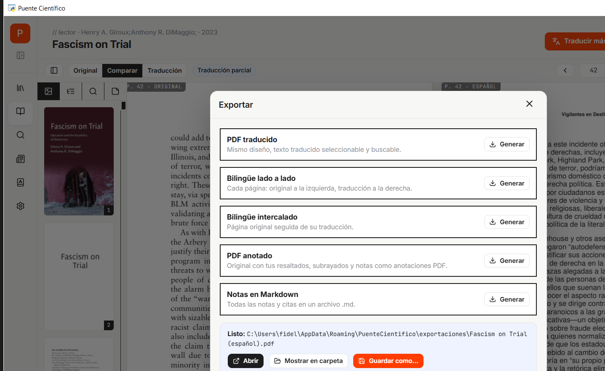

# Puente Científico

App de escritorio para Windows, en español, que reúne varios proyectos de código abierto en una sola herramienta para investigadores, estudiantes y profesionales que necesitan acceder, traducir y organizar literatura científica.

## Capturas de pantalla



*Lector de PDF con vista comparar (original/traducción), panel de miniaturas y opciones de exportación.*

## Proyectos integrados

| Proyecto original | Qué aporta |
|---|---|
| [PageBridge](https://github.com/txp666/PageBridge) | Biblioteca PDF, traducción que conserva la maquetación, vista original/comparar/traducción, glosarios, asistente con citas de página, búsqueda de literatura en OpenAlex |
| [SciHubEVA](https://github.com/leovan/SciHubEVA) | Cliente de Sci-Hub: DOI, PMID, URL y rangos `{1-10}`, rotación de espejos, XPath configurables, CAPTCHA asistido, DDoS-Guard, proxy HTTP/SOCKS5, formato de nombre `{id}_{year}_{author}_{title}` |
| [libgen-api-enhanced](https://github.com/onurhanak/libgen-api-enhanced) | Búsqueda en Library Genesis por todo, título o autor; temas (libros, ficción, cómics, revistas, normas), filtros y enlace directo de descarga |
| [annas-archive](https://github.com/LilyLoops/annas-archive) | Código del sitio de Anna's Archive. La app consulta una instancia pública con su formato de tabla y usa su API de descarga rápida para miembros, o LibGen por md5 |
| [Tor](https://www.torproject.org/) | Túnel de privacidad opcional, solo para literatura y sin permisos de administrador; resuelve bloqueos de DNS o de dominio |
| [science-hub](https://github.com/goldruma/science-hub) | Agregador de noticias y convocatorias con fuentes RSS/HTML, etiquetas por nivel, área y categoría, y deduplicación. Adaptado a fuentes científicas en español y actualizado en segundo plano en vez de GitHub Actions |

---

## Módulos

### Biblioteca

Gestiona tu colección de documentos PDF de forma inteligente:

- **Importación flexible:** arrastra y suelta archivos o carpetas completas, o usa el botón de importar
- **Organización:** crea subcarpetas para clasificar por tema, proyecto o cualquier criterio; marca favoritos y accede a documentos recientes
- **Deduplicación automática:** detecta archivos repetidos por hash SHA-256 antes de importarlos
- **Metadatos enriquecidos:** completa automáticamente título, autores, año, revista y DOI consultando OpenAlex
- **Búsqueda de texto completo:** encuentra cualquier término dentro de tus PDFs originales y sus traducciones usando SQLite FTS5
- **Papelera:** recupera documentos eliminados por error antes de borrarlos definitivamente

### Lector de PDF

Visualiza y anota documentos con herramientas pensadas para lectura académica:

- **Renderizado eficiente:** carga diferida de páginas para abrir documentos grandes sin esperar
- **Texto seleccionable:** copia fragmentos directamente del PDF
- **Navegación:** panel de miniaturas, índice extraído del documento y búsqueda dentro del archivo
- **Anotaciones persistentes:**
  - Resaltados en múltiples colores para categorizar información
  - Subrayados para énfasis
  - Notas vinculadas a posiciones específicas del texto
  - Marcadores para saltar a secciones importantes
- **Exportación de notas:** genera un archivo Markdown con todas tus anotaciones organizadas por página

### Traducción con maquetación

Traduce artículos científicos conservando el diseño original del documento:

- **Preservación del formato:** columnas, figuras, tablas, ecuaciones y fondos se mantienen en su lugar
- **Modelos de IA:**
  - **Ollama (local):** traducción privada sin enviar datos a Internet
  - **APIs compatibles con OpenAI:** GPT-4, Claude u otros proveedores
  - **FreeLLMAPI:** proxy local que agrega claves gratuitas de múltiples proveedores
- **Control granular:**
  - Traduce rangos de páginas específicos (`1-5, 8, 12-15`)
  - Reintenta párrafos individuales que no quedaron bien
  - Edita manualmente cualquier párrafo traducido
  - Retraducir solo los párrafos que contienen términos de un glosario activo
- **Vistas:** original, traducción o comparación lado a lado

### Exportación

Genera archivos listos para compartir o imprimir:

- **PDF traducido:** documento completo en el idioma destino
- **PDF bilingüe lado a lado:** original e idioma destino en páginas enfrentadas
- **PDF bilingüe intercalado:** cada párrafo seguido de su traducción
- **PDF anotado:** documento original con todos tus resaltados y notas visibles
- **Notas en Markdown:** archivo de texto con todas las anotaciones, listo para usar en Obsidian, Notion o cualquier editor

### Asistente IA

Haz preguntas sobre tus documentos y recibe respuestas con citas verificables:

- **Contextos de pregunta:**
  - Sobre el documento completo
  - Sobre la página actual
  - Sobre texto seleccionado
  - Preguntas libres (sin contexto de documento)
- **Citas con referencia:** cada respuesta incluye marcadores `[p. N]` que enlazan directamente a la página fuente
- **Mismo modelo que traducción:** usa Ollama local o tu API preferida

### Glosarios

Mantén consistencia terminológica en tus traducciones:

- **8 glosarios integrados** de inglés a español:
  - Medicina general
  - Virología
  - Estadística
  - Inteligencia Artificial
  - Redacción académica
  - Química
  - Física
  - Ingeniería
- **Glosarios personalizados:** importa y exporta en formato TXT o CSV
- **Extracción automática:** analiza un documento para sugerir términos candidatos a incluir en tu glosario
- **Retraducción selectiva:** actualiza solo los párrafos afectados cuando modificas el glosario

### Literatura (artículos)

Busca y descarga artículos científicos de múltiples fuentes:

- **OpenAlex:** base de datos abierta con más de 250 millones de obras académicas
  - Búsqueda por título, autor o texto libre
  - Filtros por año, tipo de documento, acceso abierto
  - Un clic en cualquier autor muestra todas sus publicaciones (usando su ID único de OpenAlex, sin confundir homónimos)
- **Descarga inteligente:**
  - Prioriza copias de acceso abierto cuando existen
  - Sci-Hub como alternativa con rotación automática de espejos
  - Manejo de CAPTCHAs y protección DDoS-Guard
- **Búsqueda con IA:** describe lo que buscas en lenguaje natural y el asistente genera consultas optimizadas, busca en múltiples fuentes y puntúa la relevancia de cada resultado
- **Cola de descargas:** procesa múltiples artículos en segundo plano con registro en vivo del progreso

### Libros

Accede a libros y documentos desde Library Genesis y Anna's Archive:

- **LibGen:** búsqueda por título, autor o tema en las categorías de libros, ficción, cómics, revistas y normas técnicas
- **Anna's Archive:** interfaz alternativa con descarga rápida para miembros o fallback a LibGen por md5
- **Búsqueda con IA:** igual que en artículos, describe lo que necesitas y el asistente optimiza la búsqueda
- **Conversión automática:** EPUB, MOBI, FB2, CBZ y XPS se convierten a PDF al importarlos a la biblioteca
- **Filtros:** idioma, tipo de contenido, año de publicación

### Noticias

Mantente al día con las últimas novedades científicas en español:

- **16 fuentes verificadas:**
  - Periódicos: El País, El Mundo, La Vanguardia, Europa Press
  - Divulgación: The Conversation, UNAM, Naukas
  - Convocatorias: becas, SECIHTI, olimpiadas científicas (vía Google Noticias)
- **Fuentes personalizadas:** añade cualquier feed RSS o página HTML con noticias
- **Etiquetas automáticas:** clasificación por nivel académico, área de conocimiento y categoría
- **Deduplicación:** elimina noticias repetidas de diferentes fuentes
- **Actualización en segundo plano:** las fuentes se refrescan automáticamente según el intervalo configurado

### Túnel de red

Evita bloqueos de acceso sin instalar software adicional:

- **Conexión directa:** usa tu conexión normal de Internet
- **Tor integrado:** 
  - Se ejecuta como proceso hijo, sin necesidad de instalar el navegador Tor
  - No requiere permisos de administrador
  - Puentes Snowflake u obfs4 para países con censura
  - Selección de país de salida (`de,nl,us...`)
- **Proxy externo:** usa el SOCKS5 o HTTP de tu VPN existente
- **Alcance configurable:** aplica el túnel solo a sitios bloqueados (Sci-Hub, LibGen, Anna's) o a todo el tráfico de literatura

---

## Interfaz

- **Dos skins:** brutalista (bordes marcados, colores sólidos) y minimalista (líneas finas, espacios amplios)
- **Temas:** claro y oscuro, con color de acento personalizable
- **Ventana nativa:** WebView2 con barra de título integrada
- **Atajos:**
  - `Ctrl+B`: oculta/muestra el menú lateral
  - Doble clic en borde de panel: oculta/muestra el panel
  - Arrastrar borde: redimensiona paneles
- **Controles de densidad:** ajusta el tamaño de tarjetas y el ancho de columnas

---

## Instalar

Descarga `PuenteCientifico-Setup-<versión>.exe` desde [Releases](https://github.com/humanx123/puente-cientifico/releases).

- No necesita permisos de administrador
- Se instala en `%LOCALAPPDATA%\Programs\PuenteCientifico`
- El instalador puede instalar Ollama y un modelo de traducción de forma opcional

**Datos del usuario:** se guardan en `%APPDATA%\PuenteCientifico` (biblioteca, traducciones, notas, ajustes). Desinstalar la app no los borra.

**Problemas al abrir:** ejecuta **Diagnóstico de Puente Científico** desde el menú Inicio. Genera un informe en el Escritorio con información para reportar el problema.

---

## Compilar desde el código

**Requisitos:** Windows 10/11 x64, Node 18+, Python 3.11, Inno Setup 6.

```powershell
powershell -ExecutionPolicy Bypass -File build\build.ps1
```

El instalador queda en `build\dist\`.

---

## Desarrollo

```powershell
# Backend
py -3.11 -m venv .venv
.venv\Scripts\pip install -r backend\requirements.txt
.venv\Scripts\python backend\run.py --navegador     # API en http://127.0.0.1:8777

# Frontend (en otra terminal)
cd frontend
npm install
npm run dev    # Interfaz con recarga en caliente en http://localhost:5173
```

---

## Arquitectura

```
backend/
  run.py            lanzador: elige puerto, arranca uvicorn y abre la ventana pywebview (WebView2)
  server.py         API FastAPI y servidor de la interfaz compilada
  puente/
    library.py      biblioteca, renderizado, búsqueda FTS5, notas, exportación
    translate.py    extracción por bloques, traducción por lotes y reconstrucción del PDF
    llm.py          Ollama o API compatible con OpenAI
    assistant.py    preguntas con recuperación de páginas y citas
    glossary.py     glosarios y extracción de términos
    literature.py   OpenAlex, acceso abierto y Sci-Hub (lógica de SciHubEVA)
    news.py         RSS/HTML, etiquetas y programador (lógica de science-hub)
frontend/           React + Vite, se compila a backend/static
build/              Python embebido, instalador Inno Setup, icono
```

---

## Aviso legal

Usa Sci-Hub y Library Genesis conforme a la legislación de derechos de autor de tu país. La app prioriza las copias de acceso abierto cuando existen.

---

## Donar

Si esta app te ayuda en tu investigación, considera apoyar su desarrollo:

**Bitcoin:** `bc1qd9j45f4t0jwyhjhqh2kvz2cr7k8xye460rr2y7`
